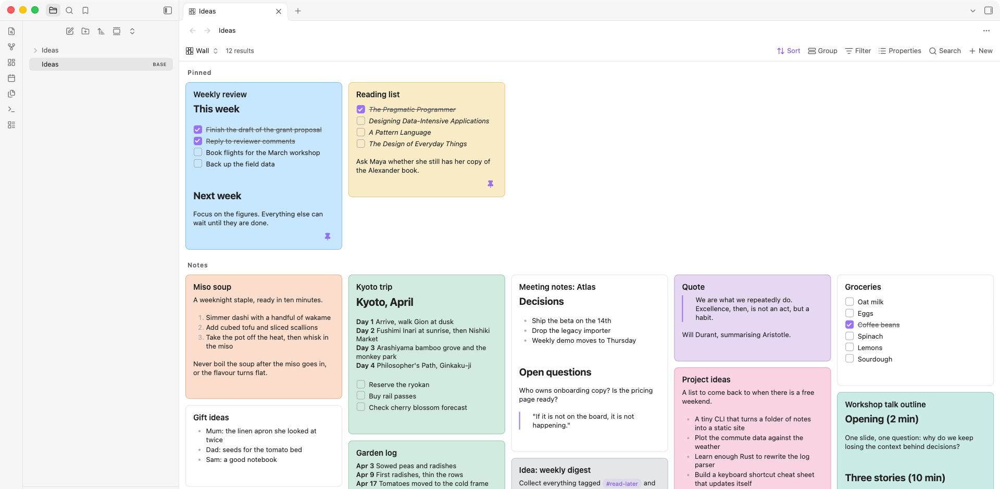

# Card Wall

A [Bases](https://help.obsidian.md/bases) view for Obsidian that lays the notes of a Base out as a wall of cards, packed with no gaps. Reorder them by dragging, pin and color them, tick tasks and fix typos without leaving the view.



## Features

- **Packed cards.** Each note is a card; cards fill the shortest column, so there are no holes. Long notes are cut at a maximum height with a fade and a "Read more" line; click a card to read the whole note.
- **Drag to reorder.** The order is stored in each note's frontmatter (`order`). Dragging changes only the note you moved.
- **Pin.** Pinned cards move into their own group above the rest (`pinned: true`).
- **Color.** Pick one of nine colors from a palette (`color: yellow`). Colors are tints of your theme, so they stay readable in light and dark.
- **Tick tasks on the card.** Clicking a checkbox changes that one line in the note.
- **Edit in place.** In the opened note, "Edit" switches to a plain text box that saves automatically. Frontmatter is never touched.
- **Fast with large folders.** Only the cards near the screen exist in the page, so thousands of notes stay responsive.
- **English and Japanese.** The interface follows Obsidian's language setting.

## Use

1. Create a Base (filter by folder, tag, anything) and add a view of type **Card Wall**.
2. To reorder, sort the Base by the `order` property, ascending. If no note has an `order` yet, press **Set up order** once: it writes `order` (1, 2, 3 …) to every note in the view.
3. Drag cards to reorder, hover a card for the pin and color buttons, click a card to read or edit it.

### How the order is stored

- The first setup writes `order` to every note in the view, once, when you press the button.
- After that, a drag changes only the moved note: it takes the value halfway between its new neighbours (so it may be `227.5`).
- If neighbours end up with the same value (for example after a sync conflict), only the notes around the drop are renumbered. Notes without an `order` sort last.
- Pinned and other cards are ordered separately, and cards stay within their group while dragging.

### Options

In the view's options you can change the property names (`order`, `pinned`, `color`), the card width and the maximum card height.

Drag and drop uses the browser's drag events, so reordering is not available on touch screens. Everything else works on mobile.

## Install

Card Wall needs Obsidian 1.10.0 or later (Bases custom views). Until it is in the community plugin list, install it from a release.

### From a release, by hand

1. Open the [latest release](https://github.com/kmu/obsidian-card-wall/releases/latest) and download three files: `main.js`, `manifest.json` and `styles.css`.
2. In your vault's folder, make the folder `.obsidian/plugins/card-wall/`. The name must be `card-wall`. `.obsidian` is hidden: press `Cmd+Shift+.` in the macOS Finder, turn on *Hidden items* in the Windows Explorer View menu, or press `Ctrl+H` in most Linux file managers.
3. Put the three files in that folder.
4. In Obsidian open **Settings → Community plugins**. If *Restricted mode* is on, turn it off. Press the reload icon next to *Installed plugins* (or restart Obsidian), then switch **Card Wall** on.

### From a release, in a terminal

Run this from inside your vault (macOS and Linux; on Windows use Git Bash or WSL):

```sh
mkdir -p .obsidian/plugins/card-wall && cd .obsidian/plugins/card-wall
for f in main.js manifest.json styles.css; do
  curl -fsSLO "https://github.com/kmu/obsidian-card-wall/releases/latest/download/$f"
done
```

Then enable the plugin as in step 4 above.

### Update

Download the three files again over the old ones, then restart Obsidian (or switch the plugin off and on). Your notes are untouched: the plugin keeps no data of its own, only the `order`, `pinned` and `color` lines in your notes' frontmatter, and the options saved in your Base files.

### Check that it works

1. Create a Base and add a view; **Card Wall** should be in the list of view types.
2. Choose it. Your notes appear as cards.

If Card Wall is missing from the list, check that the folder is exactly `<vault>/.obsidian/plugins/card-wall/`, that it holds all three files, and that the plugin is switched on.

### Uninstall

Switch the plugin off, then delete the `card-wall` folder. Lines it wrote to your notes (`order`, `pinned`, `color`) stay; they are ordinary properties.

## Development

```
npm install
npm run dev     # watch build to main.js
npm test
npm run lint
npm run build
```

To try it, symlink `main.js`, `manifest.json` and `styles.css` into a test vault's `.obsidian/plugins/card-wall/`. A manual test list is in `docs/manual-testing.md`.

To release: set the same version in `manifest.json` and `versions.json`, commit, then push a tag with exactly that version (for example `0.1.0`). The release workflow builds and attaches the three files.

## License

[MIT](LICENSE)
